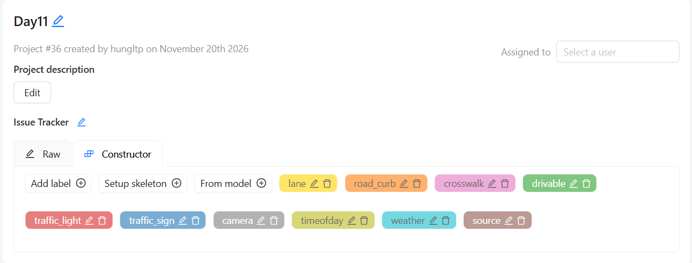
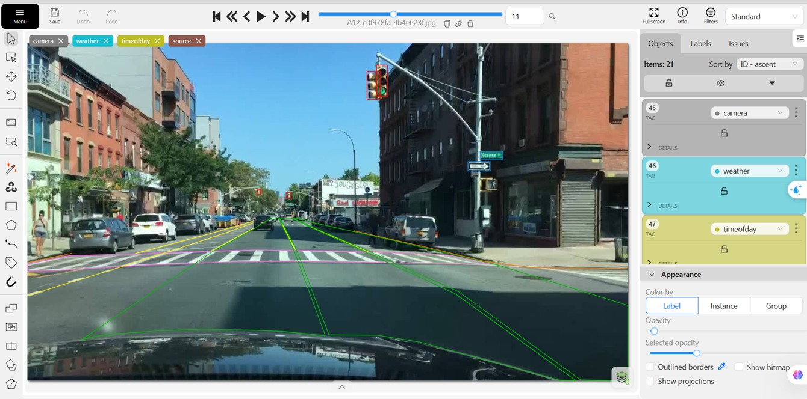
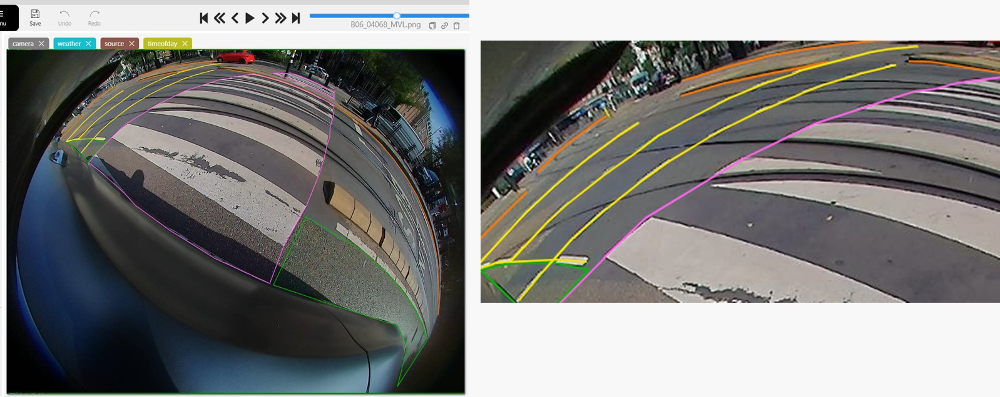
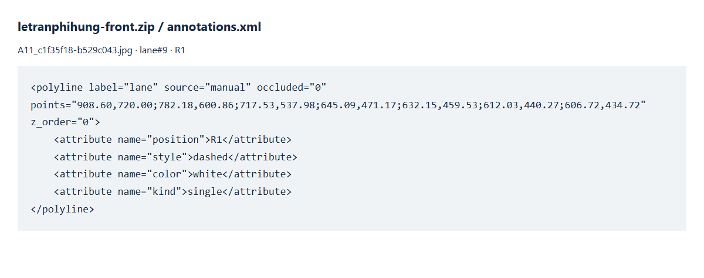

# Báo cáo cá nhân — Ngày 11
Họ tên: Lê Trần Phi Hùng    Mã học viên: 2A202603353  
Phiên bản CVAT (Help → About): 2.81.0  
Guideline: Road v1.0    Lần nộp (`revision` trong manifest): 2  
Thời điểm export (ngày giờ trên CVAT): 21/11/2026, front 11:04:20, fisheye 11:05:34 (giờ Việt Nam, revision 1). Revision 2 sửa trực tiếp từ hai ZIP.    Số lần nộp lại sau Rework: 1  

## 1. Kiểm project
| Mục | Đúng như guideline Road v1.0? | Ghi chú |
| --- | --- | --- |
| 6 label, đúng kiểu | Có | `lane`, `road_curb` là polyline, `crosswalk`, `drivable` là polygon, `traffic_light`, `traffic_sign` là rectangle. |
| Thuộc tính và giá trị | Có | Tên thuộc tính, kiểu và tập giá trị trong XML khớp taxonomy Road v1.0. |
| 4 tag ảnh | Có | 28/28 ảnh đủ `camera`, `timeofday`, `weather`, `source`. Revision 2 có 28/28 tag camera đúng. |

Cách kết thúc polyline trên bản CVAT này: Chọn **Polyline → Shape**, vẽ từ gần xe ra xa rồi nhấn **N**.  
Cách đặt tag ảnh trên bản CVAT này: Chọn **Tag**, đặt `camera` trước, chọn `value` trong **Details**, đặt ba tag còn lại rồi nhấn **Ctrl+S**.  

## 2. Số lượng đã gán
| Task | Ảnh | lane | road_curb | crosswalk | drivable | traffic_light | traffic_sign |
| --- | ---: | ---: | ---: | ---: | ---: | ---: | ---: |
| front | 12 | 34 | 23 | 7 | 26 | 45 | 48 |
| front-extra (đã làm 4 / 4) | 4 | 12 | 9 | 3 | 9 | 12 | 16 |
| fisheye | 8 | 14 | 29 | 15 | 17 | 7 | 10 |
| fisheye-extra (đã làm 4 / 4) | 4 | 2 | 12 | 8 | 9 | 0 | 0 |

## 3. Bảng ca khó
| Ảnh | Nhãn | Phân vân giữa | Đã chọn | Lý do |
| --- | --- | --- | --- | --- |
| A05 | lane | Vẽ L1/R1 theo hai hàng xe đỗ hoặc để trống | Để trống cả hai phía | Không thấy sơn phân làn. Hàng xe đỗ giúp xác định phần đường đi được, nhưng không cho biết tâm vạch sơn. Cần coach xác nhận miễn QC1-02. |
| B08 | lane#7 | Dùng L1/R1 hoặc `other` | `other` | Hậu tố MVR là camera bên phải. Ở góc nhìn bên, guideline yêu cầu dùng `other`. |
| B11 | lane trong khu vực ô đỗ | Gán biên ô đỗ thành lane hoặc bỏ qua | Không tạo lane | Các nét bao ô đỗ dành cho người khuyết tật. Đường bao chỗ đỗ không phải biên làn xe chạy. Tag camera đã được sửa thành `fisheye_rear`. |

## 4. Phiếu QC 1 nhận được
Bạn kiểm lô của tôi: Lê Tuấn Anh    Quyết định nhận được: **Rework**  
| Mã lỗi | Số lỗi | Đồng ý? | Đã sửa? |
| --- | ---: | --- | --- |
| QC1-01 | 2 nặng | Có | Đã sửa camera B02 và B06. |
| QC1-03 | 1 nặng | Có | A01 đổi `L2` của vạch bên phải thành `R1`. |
| QC1-04 | 2 chính | Có | Chỉnh điểm đầu R1 ở A08. Vẽ vạch vàng đôi A11 từ gần ra xa. |
| QC1-05 | 3 chính | Có | Nối hai đoạn L2 ở A08. Gộp hai polyline của mỗi vạch vàng đôi ở A04 và A11, giữ `kind=double`. |
| QC1-06 | 1 chính | Chờ coach xác nhận | Giữ `kind=double` tại A01 vì thấy hai nét trắng song song. Đã đặt polyline vào giữa hai nét. |
| QC1-07 | 1 chính | Có | Cắt vùng lái A11 khỏi dải xe đỗ và đổi phần làn bên cạnh thành `alternative`. |
| QC1-08 | 1 nặng + 1 chính | Có | Đổi đèn A08 #16 thành `green` và #7 thành `unknown`. |
| QC1-09 | 5 chính | Có | Sửa hướng đèn A08 #7 và #8 thành `side`, gộp #18 và #28 thành một box `front/green`. Sửa nhóm biển A08 #30 và A04 #7 thành `information`. |
| QC1-10 | 1 chính | Có | Thêm box `supplementary` cho biển “PASSENGER CARS ONLY” ở A08. |
| QC1-11 | 4 chính | Có | Bật `edge_zone` cho ba đèn B02 và cắt polygon B06 theo mép thân xe. |

## 5. Kiểm file export
| File | Mở lại được? | Số shape ảnh 1 (job / file) | Số shape ảnh 2 (job / file) | Tag camera có trong XML? |
| --- | --- | --- | --- | --- |
| letranphihung-front.zip | Có, CVAT for images 1.1 | A02 · 8 / 8 | A12 · 17 / 17 | Có, 16/16 đúng |
| letranphihung-fisheye.zip | Có, CVAT for images 1.1 | B01 · 8 / 8 | B06 · 13 / 13 | Có, 12/12 đúng |

Cột job lấy từ CVAT trước khi sửa, cột file lấy từ XML revision 2. Job 20 và job 21 đã được kiểm ở trạng thái `completed` trước khi sửa. Lint revision 2 còn 7 cảnh báo nặng (đều là QC1-02), 7 chính và 9 nhẹ. Các trường hợp QC1-02 chờ coach xác nhận gồm A05 (L1 và R1), A06 (R1), A07 (L1), A09 (R1), A10 (R1) và A14 (R1). [Manifest revision 2](letranphihung-manifest.json)

## 6. Ảnh chụp màn hình

1. Tab Labels của project.

   

2. Một ảnh camera trước đã gán đủ (làn, vùng lái, đèn/biển).

   

3. Một ảnh fisheye đã gán, phóng to đoạn polyline cong.

   

4. Một đoạn XML có <polyline label="lane">.

   

## 7. Tự đánh giá
Lỗi bạn mắc nhiều nhất hôm nay (theo mã QC1-xx), và cách tránh ở Ngày 20:

Trong sáu ảnh Tuấn Anh kiểm, **QC1-09 xuất hiện nhiều nhất với 5 lỗi**, gồm ba lỗi về hướng đèn ở A08 và hai lỗi về nhóm biển ở A04, A08. Ngày 20, em sẽ phóng to từng cụm đèn, xác định hướng của cả vỏ trước khi chọn màu, rồi đọc chức năng của biển trước khi chọn `group`. Với ảnh fisheye, em sẽ đối chiếu hậu tố FV, RV, MVL hoặc MVR với `camera.value` ngay khi mở frame. Cách kiểm này nhắm trực tiếp vào hai lỗi nặng ở B02 và B06.

Nhãn của bạn đi vào model ở đâu? Chọn một lỗi đã sửa và nói nó làm model học sai thế nào:

Một chỗ em đã bổ sung trong quá trình gán là vùng lái ở **B06**. Trong bản COCO của job 21 ngày 20/11, B06 có hai polygon `crosswalk` và chưa có polygon `drivable`. Bản CVAT XML ngày 21/11 đã có hai polygon `drivable` (#1 và #5). Nếu mặt đường đi được bị bỏ trống trong dữ liệu huấn luyện phân vùng, pixel ở đó có thể bị dùng làm nền và mô hình có thể dự đoán thiếu vùng lái. Việc bổ sung polygon xử lý phần bỏ sót trước khi đổi lô. Trong revision 2, em đã cắt polygon #1 theo mép thân xe và sửa tag thành `fisheye_left`. Nhờ vậy, pixel thân xe ít bị gán nhầm thành vùng lái và ảnh được đưa vào đúng nhóm camera.

## 8. (Tùy chọn, buffer) Từ polyline đến đích row-anchor
| y | 720 | 680 | 640 | 600 | 560 |
| --- | ---: | ---: | ---: | ---: | ---: |
| x của chúng tôi | 908,6 | 866,2 | 823,7 | 781,3 | 740,2 |
| x của bạn kia | Không có làn | 865,6 | 823,2 | 780,9 | 738,6 |

Trả lời 3 câu:

1. Năm số x đó chính là đích mà một model row-anchor học cho vạch này. Nếu bạn dừng polyline sớm 40 px, hàng nào đổi thành "không có làn"?

   Nếu Hùng dừng sớm 40 px **ở đầu xa** theo trục y, đầu xa đổi từ y=434,72 thành y=474,72. Cả năm hàng trong bảng vẫn cắt polyline. Nếu rút 40 px **ở đầu gần**, từ y=720 xuống y=680, riêng hàng 720 đổi thành “không có làn”.
2. So với bạn được kiểm (cùng ảnh): ở hàng 720 và hàng 560, hai bạn lệch nhau bao nhiêu pixel? Lệch ở hàng nào ảnh hưởng LKA nhiều hơn (slide 25)?

   Ở y=560, hai bản lệch **1,6 px**. Ở y=720, chỉ Hùng có giao điểm vì điểm đầu của Tuấn Anh ở y=719. Hàng gần nhất có thể so trực tiếp là y=719, lệch **0,7 px**. Với hỗ trợ giữ làn (LKA), hàng gần xe đặc biệt quan trọng vì nó mô tả vị trí ngang của xe so với biên làn ngay trước đầu xe.
3. Nếu polyline vẽ từ xa về gần (ngược quy tắc 2), cách tính trên có đổi không? Script nào sẽ gặp khó?

   Đảo thứ tự các điểm trên R1 này vẫn cho cùng tọa độ x ở từng hàng. Tuy vậy, điểm đầu và điểm cuối bị đổi vai trò, nên `road_check lint` và phép kiểm chiều gần–xa của `road_check check` sẽ phát hiện sai chiều.
